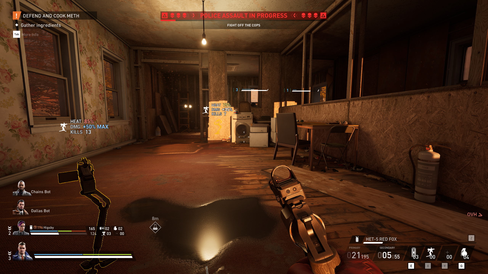

# SentryHeat

A PAYDAY 3 UE4SS mod that shows how hot your sentries are before they overheat,
plus each sentry's Machine War damage bonus and kill count.



- **Players:** download it from [Nexus Mods](https://www.nexusmods.com/payday3/mods/497) or from [Releases](https://github.com/Williscool13/SentryHeat/releases).
- **Settings in game:** works with [Will's Mod Menu](https://github.com/Williscool13/WillsModMenu) (optional); changes apply at once.

Requires [UE4SS for PAYDAY 3](https://www.nexusmods.com/payday3/mods/266).
Tested with UE4SS v3.0.1 Beta.

## Features

- Heat on every sentry, visible through walls: green under 60 %, yellow from 60 %, red from 80 % (when the game's smoke starts), pulsing from 90 %, **OVH** when overheated.
- Your sentries also show their Machine War damage bonus (blue at the +50 % cap) and kills since placement.
- Teammates' sentries show heat only by default, faded.
- An arrow at the screen edge points to any of your sentries that is off-screen and running hot.
- Two styles: data over each sentry (**world**), or number tags plus a table on the HUD (**panel**).
- Client-side: works whether you host or join.

## Layout

| Path | What |
|---|---|
| `SentryHeat/` | The mod (dev build): `Scripts/main.lua`, `settings.ini`, `settings.schema.json` |
| `docs/player-readme.txt` | The README.txt that ships in the zip |
| `docs/screens/` | Screenshots |
| `tests/` | Mock-world simulators (Python + [lupa](https://pypi.org/project/lupa/)) |
| `build_release.py` | Strips dev-only code, checks it, writes `release/SentryHeat-<version>.zip` |

## Development

To try the dev build, copy `SentryHeat/` into `PAYDAY3\PAYDAY3\Binaries\Win64\ue4ss\Mods\`.
Restart the game after changing the Lua file.

Release builds leave out development-only code: any line ending in `-- @dev`,
and everything between `-- @dev-begin` and `-- @dev-end`.

### Tests

Python 3 with lupa (`pip install lupa`), run from the repo root:

```
python tests/simperf.py SentryHeat/Scripts/main.lua   # sentry discovery and per-frame cost (asserts)
python tests/simtest.py SentryHeat/Scripts/main.lua   # smoke run: prints what the mod would draw
```

## How it works

- Heat is the sentry's own health: each shot deals self-damage (`SelfOverheatDamagePerShot`), so heat = 1 − Health / HealthMax. HealthMax isn't replicated, so a client uses the health it first saw.
- The Machine War bonus is the sentry's `OutgoingDamageMultiplier` attribute, capped at 1.5 (+50 %). The skill's tooltip says up to 150 % bonus damage; the actual cap is 150 % of normal damage, and the mod shows the actual value.
- Sentries are found when someone places one (the game's deployable HUD events), not by polling, so the mod costs about 0.05 ms per frame with none out.

## License

[MIT](LICENSE).
